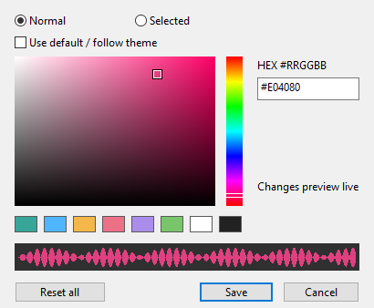

# 波形颜色设置

0.4.3 新增独立取色面板，无需额外安装界面扩展。

## 打开与操作

在 REAPER 的主动作列表搜索 **Customize waveform colors**，执行 `Media Explorer: Customize waveform colors...`。可给这个动作分配快捷键或添加工具栏按钮。

- **Normal / Selected**：分别设置普通行和选中行的波形颜色。
- **取色区域和色相条**：点击或拖动调色；面板示例和 Media Explorer 实际波形实时更新。
- **常用色块 / HEX**：可一键选择常用色，或输入 `#RRGGBB` / `RRGGBB`。HEX 无效时不能保存。
- **Use default / follow theme**：恢复当前目标的原有默认色；选中波形默认继续使用主题提供的选中文字颜色。
- **Save**：保存两种颜色，重启继续使用。
- **Cancel、Esc 或关闭窗口**：撤销本次未保存的变化，恢复打开面板前的颜色。
- **Reset all**：预览恢复两种默认色，仍需点 Save 才保存；点 Cancel 可撤回重置。

主动作 `Media Explorer: Reset waveform colors to defaults` 可以直接恢复并保存两种默认色。

## 保存位置和格式

使用 REAPER 自带 `GetExtState` / `SetExtState`，section 为 `MediaWaveThumbnails`：

| key | 值 |
| --- | --- |
| `color_normal` | 普通波形色，如 `#E04080` |
| `color_selected` | 选中波形色，如 `#50B5FF` |

两者均使用标准 RGB 格式，不保存 Windows/SWELL 各自的原生颜色整数；空值表示默认。Save 使用 `SetExtState(..., true)` 持久保存，由 REAPER 管理资源目录中的 `reaper-extstate.ini`。设置属于当前 REAPER 资源目录，独立于工程文件。

实时预览只更新插件内存中的候选颜色，不反复写磁盘。Cancel 不写持久设置；Save 或直接执行恢复默认动作才写入。插件启动时读取保存值；若用脚本直接修改 ExtState，可重启 REAPER 后读取新值。

## 绘制与性能

颜色变化只清理可丢弃的绘图位图并请求重画，保留会话峰值数组，不重新读取音频/reapeaks、不重建峰值、不增加磁盘缩略图缓存。颜色值继续参与位图缓存键。取色区域的渐变图缓存复用，拖动饱和度/明度时直接贴图。

窗口打开时拦截自己的键盘事件，HEX 输入不会触发 REAPER 主窗口快捷键；Enter 保存有效值，Esc 取消。关闭或卸载插件时回收窗口、位图和键盘回调。

## 验证（2026-11-11）

- Windows REAPER 7.84：`tests/color-ui.lua` 返回 `COLOR_UI_PASSED`，覆盖 HEX、取色区域拖动、色相条、实时预览不提前持久化、取消恢复、无效输入保护、两种颜色保存、重置后取消。
- 实际退出并重启后，`tests/color-restart.lua` 返回 `COLOR_RESTART_PASSED`，验证两种颜色恢复及保存默认值，随后恢复测试前的原始偏好。
- 实际列表截图核对普通/选中波形分别为粉色和蓝色；预览期间源创建和 direct peak read 计数没有增加。
- 原有波形/缓存回归及点击试听回归通过。
- [构建 42857999958](https://github.com/dsyrock/reaper-media-wave-thumbnails/actions/runs/42857999958) 对应代码 `c6f8b7be92efac192629201520905ca95aa30264`，Windows、Mac arm64/x86_64、Linux 全部通过。颜色格式、HSV、保存/取消/重启/重置的模型测试在各平台执行；Linux 模拟宿主还校验保存的两种颜色进入实际光栅像素，以及重置不打开音频。
- 新面板的实际交互验证目前为 Windows；Mac/Linux 面板已编译，但仍需实机 UI 回归。此前用户反馈的 Mac/Linux 0.4.2 验证记录不当作本面板的验证结果。

Windows 本轮实测 DLL SHA-256：`0517d5c4c1cdf86c4f66d6e8e5c1fe917388c5d2a019f6dfa9c5a0508f399e1a`。
